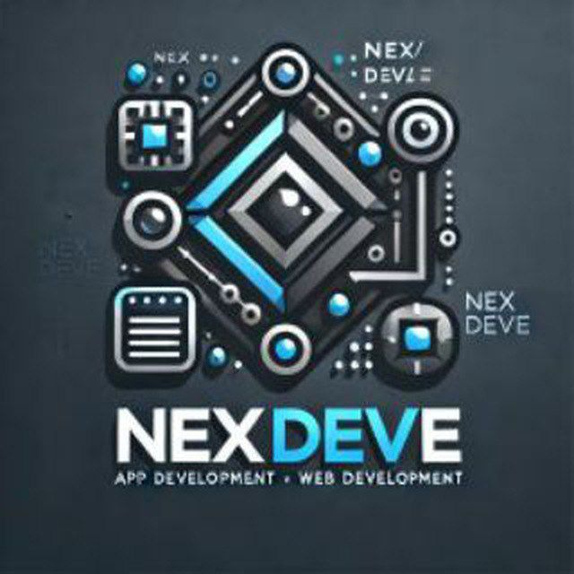

<p align="center">
  
</p>

<h1 align="center">NEX</h1>

<p align="center">
  <b>A fast, safe and simple programming language by <a href="https://nexdeve.com">NexDeve</a>.</b><br>
  Statically typed · compiled to verified bytecode · written in Rust
</p>

<p align="center">
  <a href="https://github.com/nex-deve/nex/actions/workflows/ci.yml"></a>
  
  
  <a href="#license"></a>
</p>

<p align="center">
  <a href="#quick-start">Quick start</a> ·
  <a href="#a-taste-of-nex">Examples</a> ·
  <a href="SPEC.md">Language spec</a> ·
  <a href="ROADMAP.md">Roadmap</a> ·
  <a href="https://nexdeve.com">nexdeve.com</a>
</p>

---

```rust
app Hello {
    let name = "NexDeve"
    let langs = ["NEX", "Rust", "Dart"]

    say "Hello, {name}!"
    for lang in langs.sorted() {
        say "- {lang} has {lang.len()} letters"
    }
}
```

```console
$ nex run hello.nex
Hello, NexDeve!
- Dart has 4 letters
- NEX has 3 letters
- Rust has 4 letters
```

## Why NEX?

| | |
|---|---|
| **Simple** | Small, readable syntax: `let`, `var`, `fn`, `if`, `for`, `say`. No semicolons needed. |
| **Safe** | Static types catch mistakes before the program runs. Integer overflow, out-of-bounds indexes and missing map keys are clear errors, never silent bugs or crashes. |
| **Verified** | Every program is compiled to bytecode and checked by a verifier before the VM runs it, including bytecode loaded from files. |
| **Helpful errors** | Every error shows the file, line, column and the exact spot in your code. |
| **Portable** | Tested on Linux, Windows and macOS on every change. No dependencies beyond Rust. |

> **Status: alpha.** NEX is young and not production-ready yet. Everything
> listed under [Features](#features) works and is tested; file I/O,
> modules, networking and more are on the [roadmap](ROADMAP.md).

## Quick start

NEX is built from source with a stable [Rust](https://rustup.rs) toolchain.

```sh
git clone https://github.com/nex-deve/nex.git
cd nex
cargo install --path crates/nex-cli   # installs the `nex` command
```

Create and run your first project:

```sh
nex new hello
cd hello
nex run
```

> **Windows:** the default Rust (MSVC) toolchain needs Visual Studio Build
> Tools with the Windows SDK. If linking fails, see
> [CONTRIBUTING.md](CONTRIBUTING.md#windows-notes).

## A taste of NEX

**Functions and types**

```rust
fn grade(score: Int) -> Str {
    if score >= 80 {
        return "A"
    } else if score >= 60 {
        return "B"
    }
    return "C"
}

app Grades {
    let scores = {"Rahad": 91, "Ana": 74, "Sam": 55}
    for name in scores {
        say "{name}: {grade(scores[name])}"
    }
}
```

**Collections**

```rust
app Shop {
    var cart: [Str] = []
    cart.push("rice")
    cart.push("oil")
    cart.push("rice")

    let prices = {"rice": 75.0, "oil": 180.0}
    var total = 0.0
    for item in cart {
        total = total + prices.get(item, 0.0)
    }
    say "{cart.len()} items, total {total}"   // 3 items, total 330.0
}
```

**Clear errors**

```console
$ nex run divide.nex
runtime error: division by zero
  at fn divide (divide.nex:2:14)
  at app Main (divide.nex:7:9)
 --> divide.nex:2:14
  |
2 |     return a / b
  |              ^
```

More programs live in [`examples/`](examples). Every example is run by the
test suite, so they always work.

## Features

- **Types:** `Int`, `Float`, `Bool`, `Str`, arrays `[T]`, maps `{K: V}`
- **Variables:** `let` (fixed) and `var` (changeable), with type inference
- **Control flow:** `if` / `else if` / `else`, `while`, `for` over ranges,
  arrays and maps, `break`, `continue`
- **Functions** with typed parameters, return values and recursion
- **String interpolation:** `"total: {a + b}"`
- **Methods:** `push`, `pop`, `sorted`, `slice`, `keys`, `get`, `split`,
  `trim`, `replace`, `upper`, and [more](SPEC.md#9-methods)
- **Built-ins:** `sqrt`, `floor`, `round`, `parse_int`, `parse_float`,
  `to_int`, `to_float`
- **Tooling:** `nex run`, `check`, `build`, `disasm`, `new`

## Command line

| Command | What it does |
|---|---|
| `nex run [FILE]` | Compile and run a `.nex` file (or a built `.nexdeve` file) |
| `nex check [FILE]` | Find errors without running anything |
| `nex build [FILE]` | Compile to a verified `.nexdeve` bytecode file that runs without the source |
| `nex disasm [FILE]` | Show the bytecode |
| `nex new NAME` | Create a new project |

Useful options: `--app NAME` runs one app; `--max-steps N` and
`--max-call-depth N` limit untrusted programs. Run `nex --help` for details.

<details>
<summary>Exit codes</summary>

| Code | Meaning |
|---|---|
| 0 | success |
| 1 | compile error (syntax, name, type), or no `app` to run |
| 2 | usage error, unreadable file, or unimplemented command |
| 3 | runtime error (overflow, division by zero, resource limit) |
| 4 | invalid or corrupted `.nexdeve` file |

</details>

## Roadmap

| Stage | What it adds | Status |
|---|---|---|
| 1 | Core language, functions, arrays, maps, floats, `for` | ✅ done |
| 2 | File I/O, user input, modules (`use`), error handling | ⏳ next |
| 3 | HTTP and JSON (websites, APIs, bots) | planned |
| 4 | Hashing and networking (blockchain experiments, network tools) | planned |
| 5 | Hardware access (serial / GPIO) | planned |

Full details in [ROADMAP.md](ROADMAP.md).

## Documentation

- [Language specification](SPEC.md): grammar, types, methods, limits
- [Architecture](docs/ARCHITECTURE.md): compiler pipeline, bytecode, VM
- [Security](SECURITY.md): what the VM protects against, and what it doesn't
- [Contributing](CONTRIBUTING.md): building, testing and adding tests
- [Changelog](CHANGELOG.md)

## Contributing

Bug reports and ideas are welcome. Please open an
[issue](https://github.com/nex-deve/nex/issues). Before sending a change, run:

```sh
cargo fmt --all --check
cargo clippy --workspace --all-targets -- -D warnings
cargo test --workspace
```

## License

Licensed under either of [Apache License, Version 2.0](LICENSE-APACHE) or
[MIT license](LICENSE-MIT), at your option. Unless you state otherwise,
any contribution you submit for inclusion in NEX is dual-licensed the same
way, without any additional terms.

<p align="center">Made by <a href="https://nexdeve.com">NexDeve</a></p>
